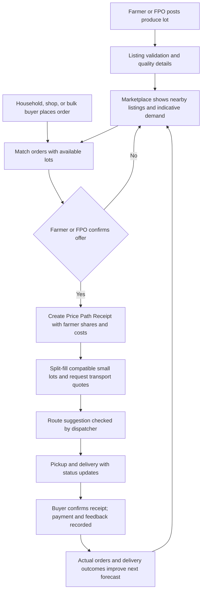

# Smart India Hackathon Workshop

## SIH 26033 Submission

**Date:** 25 November 2026  
**Reference Number:** 26019357
**Name:** Hari Prasanth D

## Problem Title

**SIH 26033: Multiple intermediaries reduce farmers' earnings and increase consumer prices**

## Problem Creator's Organization

Ministry of Consumer Affairs, Food & Public Distribution

## Theme

Agriculture, FoodTech & Rural Development

## Problem Description

Small farmers often sell through several layers of aggregation and resale before produce reaches consumers. Each handoff can add costs, delay delivery, and reduce the farmer's share of the final price. At the same time, buyers may have difficulty finding nearby produce, comparing offers, and arranging dependable transport. The challenge is to connect farmers and farmer-producer organisations (FPOs) more directly with households, shops, institutions, and other bulk buyers while coordinating logistics and matching supply to demand.

## Proposed Solution

### HarvestLink Local

HarvestLink Local is a proposed digital marketplace that groups nearby produce and buyer orders around village collection points. A farmer or FPO posts a listing with crop, available quantity, harvest date, grade or quality notes, preferred price, and pickup location. Buyers can compare listings and place orders directly. The farmer or FPO remains the seller and confirms the final offer; the platform does not silently set prices.

The marketplace uses a **split-fill board**. A buyer posts the quantity, acceptable grade, delivery window, and maximum collection radius needed. The system can suggest a single lot or a bundle of smaller lots from nearby farms, but only when crop, grade, and delivery timing meet the buyer's stated conditions. Each farmer separately accepts or declines their part, so the buyer sees which farms will fill the order and no farmer is silently committed.

Every confirmed order creates a **Price Path Receipt**: a simple record showing the agreed produce value, each farmer's amount, transport, platform fee, and buyer's delivered total. If the buyer later reports a quality adjustment or a delivery charge changes, the receipt records the reason and who approved it. Receipts are visible to the transaction participants and can be downloaded or printed; the platform does not claim to know prices in transactions that happen outside it. Transporters can quote on pooled pickups, and both sides see the cost breakdown before confirming.

A lightweight demand forecast estimates likely orders by crop, area, and week using previous orders, current listings, and seasonal patterns. Early versions can use simple averages and seasonal rules, then be compared with actual orders before more advanced machine learning is considered. Route planning groups confirmed deliveries by destination and vehicle capacity, with a human dispatcher able to adjust for road, timing, or produce-handling constraints.

**How it addresses the problem:** direct listings reduce the number of required resales; pooled lots help smaller farms reach buyer quantities; transparent price breakdowns make costs visible; and coordinated delivery reduces avoidable trips. The platform can begin with one crop and one nearby market, then expand after farmer and buyer feedback.

**Innovation and uniqueness:** the split-fill board lets a buyer's order be met by several small farms under explicit crop, grade, radius, and timing rules. The Price Path Receipt then records how that order's value is divided among produce, each participating farmer, transport, and disclosed service fees. Together, these features address two practical gaps: small lots can qualify for larger orders, and participants can inspect the cost path for each marketplace transaction. This is a proposed feature set, not a claim that no similar service exists; it should be checked against local platforms during discovery.

## Technical Approach

### Proposed technology

- **Farmer and buyer interface:** responsive web app / Progressive Web App, designed for low-bandwidth phones, with local-language labels and assisted entry through an FPO operator.
- **Backend:** Python with FastAPI or Django REST Framework; PostgreSQL for users, listings, orders, payments status, and delivery records.
- **Forecasting:** begin with moving averages and seasonal baselines using platform order history; evaluate forecast error by crop and week. Use a machine-learning model only when enough reliable local data exists.
- **Route planning:** group compatible split-fill lots by pickup point, destination, delivery window, and vehicle capacity, then suggest a practical route. A dispatcher confirms the plan.
- **Notifications:** SMS or WhatsApp notifications through approved providers; order status remains available in the app for users without messaging access.
- **Payments and privacy:** integrate a regulated payment provider if required for a pilot; collect only necessary personal information, use role-based access, and provide clear consent and grievance channels. Payment and legal workflows must be checked with local authorities before launch.

### Process flow

### Implementation stages

1. **Discovery:** interview farmers/FPOs, buyers, and local transporters; select one crop and service area; map applicable market rules.
2. **Prototype:** build the split-fill board and sample Price Path Receipt alongside listing, order, and offer-confirmation screens; demonstrate the process before handling real orders.
3. **Small pilot:** onboard a small group through an FPO or community facilitator; run limited order windows and manually coordinate transport.
4. **Evaluation:** track farmer net receipt, buyer total cost, fulfilment, spoilage, and forecast error; improve the service from measured results.
5. **Expansion:** add crops and locations only when operations, support, and local compliance are ready.

## Feasibility and Viability

A pilot is technically feasible with common web technologies, smartphones already used by participating buyers or FPO staff, and manual logistics coordination at the start. It does not require building warehouses or a vehicle fleet before testing demand. The first version can use a simple rules-based demand estimate and route suggestions rather than an expensive AI system.

The main operational challenge is reliable supply and quality information. HarvestLink Local can use standard listing fields, photo evidence where useful, optional FPO-assisted checks, and a clear process for resolving quality disputes. Demand may vary by season, so early forecasts should show ranges and confidence, not promise exact sales. Transport availability can be addressed through pre-booked pickup windows and more than one transporter where possible. Low connectivity can be handled with a lightweight interface and assisted listing at an FPO or collection point.

The Price Path Receipt should be generated only for marketplace transactions with participant consent; it is not a public ranking of individual farmers. Farmers and buyers should be able to see all charges before confirming. The pilot should avoid holding customer funds itself; any digital payment feature should use an established provider and be reviewed for applicable rules. Personal data should be limited to what is needed for orders and delivery, protected with access controls, and removed when no longer required. Local market, food safety, weighing, tax, and consumer-protection requirements must be checked before operating in each area.

The model can be sustained through a clearly disclosed small per-order service fee or a fee paid by institutional buyers for fulfilment support. The pilot should test willingness to pay and publish fees before any transaction; it should not rely on hidden deductions from farmer proceeds.

## Impact and Benefits

- **Farmers and FPOs:** access to more nearby buyers, clearer comparison of offers, an itemized receipt for marketplace sales, and a way to combine smaller quantities into useful lots.
- **Consumers and small retailers:** access to local produce with delivery charges shown upfront and fewer unnecessary handoffs.
- **Bulk buyers:** easier discovery of supply, consolidated ordering, and more predictable delivery planning.
- **Transporters:** fuller vehicle loads and grouped delivery routes may improve vehicle utilization.
- **Environment and food loss:** better coordination may reduce empty trips and time in transit; actual fuel and spoilage changes must be measured during the pilot rather than assumed.

Pilot success should be judged against a baseline from participating users. Suggested measures are farmer net receipt per kilogram, buyer total cost per kilogram, time from listing to sale, percentage of orders delivered as agreed, quantity rejected or spoiled, transport cost per kilogram, repeat participation, and forecast error. Results should be reported by crop and location so that average improvements do not hide poor outcomes for a group.

## Add Your Local Evidence Before Submitting

To make the proposal reflect your own work, fill in these details from your area: name one crop and nearby market you would pilot with; describe one short conversation, observation, or source that showed a real selling or delivery difficulty; and explain why you chose that pilot crop or area. Do not invent interviews or results. If you have not spoken with anyone, say that these are questions for the discovery stage.

## Research and References

1. **National Agriculture Market (e-NAM), Government of India.** Official portal describing the electronic trading platform connecting existing APMC mandis and its farmer/trader resources. https://enam.gov.in/
2. **e-NAM Registration Guidelines.** Official registration information for farmers, traders, and FPOs/FPCs. https://enam.gov.in/resources/registration-guideline
3. **AGMARKNET, Directorate of Marketing and Inspection, Government of India.** Agricultural marketing information and market-price resources that may inform local price context, subject to data availability and permitted access. https://agmarknet.gov.in/
4. **Smart India Hackathon Problem Statement 26033.** Workshop brief supplied for this submission: direct farmer/FPO-to-buyer marketplace, logistics support, demand forecasting, and route optimization.

**Research note:** These references establish relevant existing market and price-information services. HarvestLink Local is a proposed design; its results, data access, integrations, legal fit, and commercial model would need to be validated in a local pilot.

